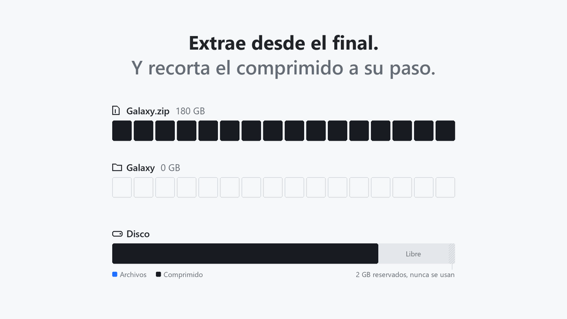

<p align="center"></p>

<h1 align="center">MoltZip</h1>

<p align="center">
  Extrae archivos enormes en el sitio. El comprimido se recorta mientras salen tus archivos,<br>
  así solo necesitas espacio libre para los archivos, no para los archivos <em>y</em> el comprimido.
</p>

<h4 align="center">
  <a href="https://morningstar-code.github.io/moltzip/es/">Sitio web</a> |
  <a href="#descargar">Descargar</a> |
  <a href="#uso">Uso</a> |
  <a href="#es-seguro">Seguridad</a> |
  <a href="README.md">English</a>
</h4>

<p align="center">
  <a href="https://github.com/morningstar-code/moltzip/releases/latest"></a>
  
  
</p>

<p align="center">
  <picture>
    <source media="(prefers-color-scheme: dark)" srcset="docs/media/moltzip-es-dark.gif" />
    
  </picture>
</p>

MoltZip es un extractor de archivos gratuito para Windows, macOS y Linux, con app de escritorio y herramienta de línea de comandos. Extrae ZIP, 7z, RAR, tar, `.tar.gz`, `.tar.xz`, `.tar.zst`, `.tar.bz2` y archivos comprimidos divididos **en el sitio**, para cuando no hay espacio en el disco para extraer un comprimido junto a sí mismo, como la descarga de un juego grande en un disco casi lleno.

## El problema que resuelve

Una descarga de 180 GB que ocupa 200 GB al extraerla necesita **380 GB** de disco con WinRAR, 7-Zip o `unzip`, porque el comprimido y todo lo extraído tienen que existir al mismo tiempo. Con MoltZip necesita **poco más de 200 GB**: extrae el comprimido desde el final y corta cada parte terminada del archivo, así el espacio que devuelve el comprimido se reutiliza para los siguientes archivos.

Antes de cambiar nada comprueba que la extracción cabe, vuelve a leer cada archivo del disco antes de cortar la parte del comprimido que lo contiene, mantiene un margen de espacio libre todo el tiempo, y se puede detener o colgar en cualquier momento y continuar donde quedó. La app de escritorio está en español e inglés.

## Descargar

> [!IMPORTANT]
> MoltZip solo se distribuye desde las [versiones de este repositorio](https://github.com/morningstar-code/moltzip/releases) y su [sitio web](https://morningstar-code.github.io/moltzip/es/).

| Sistema | Archivo |
|---|---|
| Windows 10 y 11 (x64) | [`MoltZip-x64-setup.exe`](https://github.com/morningstar-code/moltzip/releases/latest/download/MoltZip-x64-setup.exe): se instala por usuario, sin permisos de administrador, y añade el menú del clic derecho |
| Windows, MSI | [`MoltZip-x64.msi`](https://github.com/morningstar-code/moltzip/releases/latest/download/MoltZip-x64.msi): lo mismo, como paquete de Windows Installer |
| Windows, portable | [`MoltZip-x64-portable.zip`](https://github.com/morningstar-code/moltzip/releases/latest/download/MoltZip-x64-portable.zip): descomprime y ejecuta `moltzip-gui.exe` |
| macOS, Apple Silicon | [`MoltZip-aarch64.dmg`](https://github.com/morningstar-code/moltzip/releases/latest/download/MoltZip-aarch64.dmg) |
| macOS, Intel | [`MoltZip-x86_64.dmg`](https://github.com/morningstar-code/moltzip/releases/latest/download/MoltZip-x86_64.dmg) |
| Debian, Ubuntu | [`moltzip_amd64.deb`](https://github.com/morningstar-code/moltzip/releases/latest/download/moltzip_amd64.deb) |
| Fedora, openSUSE | [`moltzip-x86_64.rpm`](https://github.com/morningstar-code/moltzip/releases/latest/download/moltzip-x86_64.rpm) |
| Cualquier Linux | [`MoltZip-x86_64.AppImage`](https://github.com/morningstar-code/moltzip/releases/latest/download/MoltZip-x86_64.AppImage) |

1. Ejecuta el instalador. Las descargas aún no tienen firma de código, así que Windows puede mostrar "Windows protegió tu PC": elige **Más información** y luego **Ejecutar de todas formas**. En macOS, abre la app una vez y permítela en Configuración del Sistema, Privacidad y seguridad.
2. Haz clic derecho en el comprimido, elige **MoltZip** y luego **Extraer aquí**. En Windows 11 el menú está en **Mostrar más opciones**.
3. O abre MoltZip, abre el comprimido o arrástralo a la ventana, y elige **Extraer**.

Cada descarga tiene su suma `.sha256` al lado: [verificar una descarga](https://morningstar-code.github.io/moltzip/verify.html).

### Solo línea de comandos

Linux y macOS:

```sh
curl -fsSL https://raw.githubusercontent.com/morningstar-code/moltzip/main/install.sh | sh
```

Windows, en PowerShell:

```powershell
irm https://raw.githubusercontent.com/morningstar-code/moltzip/main/install.ps1 | iex
```

Los dos descargan la versión para tu equipo desde el último release, la comprueban con su suma SHA-256 e instalan `moltzip` y su nombre corto `mz` solo para tu usuario.

## Uso

```sh
moltzip check juego.zip                  # ¿cabe? no cambia nada
moltzip extract juego.zip                # extrae en el sitio, en ./juego/
moltzip extract juego.zip -o D:\Juegos   # en otra carpeta
moltzip x juego.7z.001                   # comprimido dividido: sirve el nombre de cualquier parte
moltzip extract juego.zip --keep-archive # extracción normal que conserva el comprimido
moltzip restore juego.zip                # abandonar: lo que queda vuelve a ser un comprimido normal
moltzip check juego.zip --json           # un documento JSON para scripts (también list y test)
```

Pulsa `Ctrl+C` para pausar y ejecuta el mismo comando para continuar. El progreso vive en dos archivos pequeños junto al comprimido, `juego.zip.moltzip` y `juego.zip.moltzip-tail`: **no los borres mientras la extracción no termine**. `moltzip --help` y `man moltzip` tienen todas las opciones.

| Código de salida | Significado |
|---|---|
| 0 | Éxito |
| 1 | Error. Si la extracción había empezado, el progreso está guardado. |
| 2 | Línea de comandos no válida |
| 3 | No hay espacio suficiente. No se cambió nada. |
| 4 | El comprimido está dañado. No se borró nada. |
| 5 | El comprimido tiene contraseña y no se dio una correcta. |
| 130 | Pausado con Ctrl+C. Ejecuta el mismo comando para continuar. |

## ¿Es seguro?

MoltZip destruye el comprimido mientras extrae, así que está construido para no perder nunca un archivo que no haya llegado bien al disco.

- **Nada cambia hasta que el plan cabe.** La comprobación de espacio simula toda la extracción para encontrar el momento que más espacio necesita, no solo el total.
- **Cada archivo se escribe, se guarda en el disco físico y se renombra antes de cortar la parte del comprimido que lo contiene.** Un cuelgue en cualquier punto deja o el archivo o sus bytes en el comprimido, nunca ninguno de los dos.
- **Cada archivo se vuelve a leer antes de cortar sus bytes del comprimido.** Se compara su tamaño y su suma con lo que se escribió, así que si un antivirus lo pone en cuarentena o lo cambia, o el disco no guardó la escritura, el proceso se detiene mientras el comprimido todavía lo contiene. `--no-verify-written` lo desactiva.
- **Un daño detiene el proceso donde está.** Se verifica la suma de cada archivo al extraerlo; uno dañado no se escribe y queda en el comprimido.
- **Los comprimidos maliciosos se rechazan antes de borrar nada:** rutas que escapan de la carpeta de salida, entradas que se solapan o se repiten, enlaces peligrosos.
- **Nunca sobrescribe** archivos existentes, salvo que elijas reemplazar, omitir o conservar ambos.
- **No usa internet.** Sin código de red, sin telemetría, sin cuentas.

Si la descarga en sí está dañada, los archivos anteriores al daño salen y el comprimido queda parcialmente consumido. Usa `--verify-first` si no puedes volver a descargarlo, o `--keep-archive` si hay espacio para ambos.

## Formatos

| Formato | Se libera de a |
|---|---|
| ZIP, ZIP64, `.exe` autoextraíbles, ZIP con contraseña | Un archivo |
| 7z, sólido y no sólido, 7z con contraseña | Un bloque sólido |
| RAR 5 y RAR 4, sueltos y por volúmenes | Un archivo; un volumen cuando queda vacío |
| tar, `.tar.gz`, `.tgz` | Un archivo (`.tar.gz`: 256 MiB de salida donde el disco puede liberar parte de un archivo) |
| Divididos (`.001`, `.002`, ...) de ZIP o 7z | Un archivo o bloque; cada volumen se borra al vaciarse |
| `.tar.xz`, `.tar.zst`, `.tar.bz2` | El comprimido entero, cuando ya salieron todos los archivos: necesitan espacio para el comprimido y los archivos a la vez, y una extracción interrumpida empieza de nuevo con el comprimido intacto |

Un 7z hecho con la configuración por defecto de 7-Zip puede ser un solo bloque sólido, que solo se libera cuando sale entero; `moltzip check` lo avisa antes de cambiar nada. Un RAR sólido solo se extrae conservando el comprimido.

## Novedades de la 0.3.0

- `.tar.xz`, `.tar.zst` y `.tar.bz2`, también divididos en `.001`
- Cada archivo se vuelve a leer del disco, y se comparan su tamaño y su suma, antes de cortar los bytes del comprimido que lo contienen
- La app de escritorio en español, según el idioma del sistema o elegido en Configuración
- Salida `--json` para `check`, `list` y `test`
- Una opción para abrir la carpeta al terminar la extracción

## Reportar un problema

Abre un [issue](https://github.com/morningstar-code/moltzip/issues). Si una extracción falló a mitad, no borres los archivos `.moltzip` y `.moltzip-tail` junto al comprimido: son los que permiten a MoltZip terminarla.

## Licencia

MoltZip es gratis, para uso personal y comercial, según su [licencia](LICENSE.md). Su código fuente no se publica.

MoltZip incluye componentes de código abierto con sus propias licencias, como UnRAR para los archivos RAR. Sus licencias vienen con cada descarga, y [THIRD-PARTY-NOTICES.md](THIRD-PARTY-NOTICES.md) las enumera.
