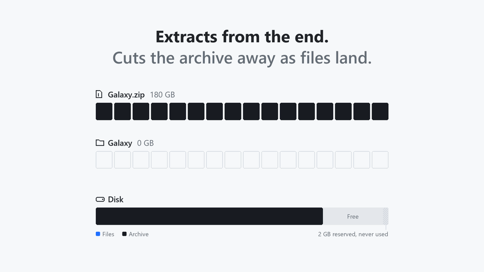

<p align="center"></p>

<h1 align="center">MoltZip</h1>

<p align="center">
  Extract huge archives in place. The archive is cut away as your files come out,<br>
  so you only need free space for the files, not for the files <em>and</em> the archive.
</p>

<h4 align="center">
  <a href="https://morningstar-code.github.io/moltzip">Website</a> |
  <a href="#download">Download</a> |
  <a href="#usage">Usage</a> |
  <a href="#is-it-safe">Safety</a> |
  <a href="README.es.md">Español</a>
</h4>

<p align="center">
  <a href="https://github.com/morningstar-code/moltzip/releases/latest"></a>
  
  
</p>

<p align="center">
  <picture>
    <source media="(prefers-color-scheme: dark)" srcset="docs/media/moltzip-en-dark.gif" />
    
  </picture>
</p>

MoltZip is a free archive extractor for Windows, macOS and Linux, with a desktop app and a command line tool. It extracts ZIP, 7z, RAR, tar, `.tar.gz` and split archives **in place**, for when there is not enough disk space to extract an archive next to itself, such as a large game download on a nearly full disk.

## The problem it solves

A 180 GB download that unpacks to 200 GB needs **380 GB** of disk with WinRAR, 7-Zip or `unzip`, because the archive and everything extracted from it have to exist at the same time. MoltZip needs **a little over 200 GB**. It extracts the archive from the end and cuts each finished part off the archive file as it goes, so the space the archive gives back is reused for the next files.

It checks that the extraction will fit before it changes anything, keeps a safety margin of free space the whole way through, and can be stopped or crash at any moment and pick up where it left off.

## Download

> [!IMPORTANT]
> MoltZip is only distributed from this repository's [releases](https://github.com/morningstar-code/moltzip/releases) and its [website](https://morningstar-code.github.io/moltzip).

| System | File |
|---|---|
| Windows 10 and 11 (x64) | [`MoltZip-x64-setup.exe`](https://github.com/morningstar-code/moltzip/releases/latest/download/MoltZip-x64-setup.exe): installs per user, no admin rights, adds the right-click menu |
| Windows, MSI | [`MoltZip-x64.msi`](https://github.com/morningstar-code/moltzip/releases/latest/download/MoltZip-x64.msi): the same, as a Windows Installer package for deployment tools |
| Windows, portable | [`MoltZip-x64-portable.zip`](https://github.com/morningstar-code/moltzip/releases/latest/download/MoltZip-x64-portable.zip): unzip anywhere and run `moltzip-gui.exe` |
| macOS, Apple Silicon | [`MoltZip-aarch64.dmg`](https://github.com/morningstar-code/moltzip/releases/latest/download/MoltZip-aarch64.dmg) |
| macOS, Intel | [`MoltZip-x86_64.dmg`](https://github.com/morningstar-code/moltzip/releases/latest/download/MoltZip-x86_64.dmg) |
| Debian, Ubuntu | [`moltzip_amd64.deb`](https://github.com/morningstar-code/moltzip/releases/latest/download/moltzip_amd64.deb) |
| Fedora, openSUSE | [`moltzip-x86_64.rpm`](https://github.com/morningstar-code/moltzip/releases/latest/download/moltzip-x86_64.rpm) |
| Any Linux | [`MoltZip-x86_64.AppImage`](https://github.com/morningstar-code/moltzip/releases/latest/download/MoltZip-x86_64.AppImage) |

1. Run the installer. The downloads are not code-signed yet, so Windows may show "Windows protected your PC": choose **More info**, then **Run anyway**. On macOS, open the app once, then allow it under System Settings, Privacy & Security.
2. Right-click the archive, choose **MoltZip**, then **Extract here**. On Windows 11 the menu is under **Show more options**.
3. Or open MoltZip, open the archive or drag it onto the window, and choose **Extract**.

Every download has a `.sha256` checksum next to it: [verify a download](https://morningstar-code.github.io/moltzip/verify.html).

### Command line only

Linux and macOS:

```sh
curl -fsSL https://raw.githubusercontent.com/morningstar-code/moltzip/main/install.sh | sh
```

Windows, in PowerShell:

```powershell
irm https://raw.githubusercontent.com/morningstar-code/moltzip/main/install.ps1 | iex
```

Both download the build for your machine from the latest release, check it against its SHA-256 checksum, and install `moltzip` and its short name `mz` for your user only.

## Usage

```sh
moltzip check game.zip                  # will it fit? changes nothing
moltzip extract game.zip                # extract in place into ./game/
moltzip extract game.zip -o D:\Games    # somewhere else
moltzip x game.7z.001                   # split archive: any part's name works
moltzip extract game.zip --keep-archive # a normal extraction that keeps the archive
moltzip restore game.zip                # give up: what is left becomes a normal archive again
```

Press `Ctrl+C` to pause and run the same command to continue. Progress lives in two small files next to the archive, `game.zip.moltzip` and `game.zip.moltzip-tail`: **do not delete them while an extraction is unfinished**. `moltzip --help` and `man moltzip` have every option.

| Exit code | Meaning |
|---|---|
| 0 | Success |
| 1 | Failure. If extraction had started, progress is saved. |
| 2 | Invalid command line |
| 3 | Not enough free space. Nothing was changed. |
| 4 | The archive is damaged. Nothing was deleted. |
| 5 | The archive is password protected and no correct password was given. |
| 130 | Paused with Ctrl+C. Run the same command to continue. |

## Is it safe

MoltZip destroys the archive as it extracts, so it is built around never losing a file that has not safely landed on disk.

- **Nothing changes until the plan fits.** The space check replays the whole extraction to find the moment that needs the most free space, not just the total.
- **A file is written, flushed to the physical disk and renamed into place before the part of the archive holding it is cut off.** A crash at any point leaves either the file or its bytes in the archive, never neither.
- **Damage stops the run where it is.** Every file's checksum is verified as it is extracted; a damaged file is not written and stays in the archive.
- **Hostile archives are refused before anything is deleted:** paths that escape the output folder, overlapping or repeated entries, dangerous links.
- **Existing files are never overwritten** unless you choose to replace, skip or keep both.
- **No network access.** No networking code, no telemetry, no accounts.

If the download itself is damaged, the files before the damage come out and the archive is partly gone. Use `--verify-first` when the archive can't be downloaded again, or `--keep-archive` when there is room for both.

## Supported formats

| Format | Freed in steps of |
|---|---|
| ZIP, ZIP64, self-extracting `.exe` ZIPs, password-protected ZIP | One file |
| 7z, solid and non-solid, password-protected 7z | One solid block |
| RAR 5 and RAR 4, single files and volume sets | One file; a volume once it is empty |
| tar, `.tar.gz`, `.tgz` | One file (`.tar.gz`: 256 MiB of output where the disk can free part of a file) |
| Split archives (`.001`, `.002`, ...) of ZIP or 7z | One file or block; each volume deleted once emptied |

A 7z made with 7-Zip's default settings can be one solid block, which can only be freed once all of it is out; `moltzip check` says so before anything changes. A solid RAR is extracted only while keeping the archive.

## Coming in 0.3.0

- `.tar.xz`, `.tar.zst` and `.tar.bz2`
- Every file read back from the disk and its checksum compared before the archive bytes holding it are cut, to catch an antivirus that quarantines a file or a write the disk did not keep
- The desktop app in Spanish, following the system language
- `--json` output for `check`, `list` and `test`
- An option to open the folder when an extraction completes

## Reporting a problem

Open an [issue](https://github.com/morningstar-code/moltzip/issues). If an extraction failed midway, do not delete the `.moltzip` and `.moltzip-tail` files next to the archive: they are what lets MoltZip finish it.

## License

MoltZip is free to use, for personal and commercial purposes, under its [license](LICENSE.md). Its source code is not published.

MoltZip includes open source components under their own licenses, such as UnRAR for RAR archives. Their licenses come with every download, and [THIRD-PARTY-NOTICES.md](THIRD-PARTY-NOTICES.md) lists them.
